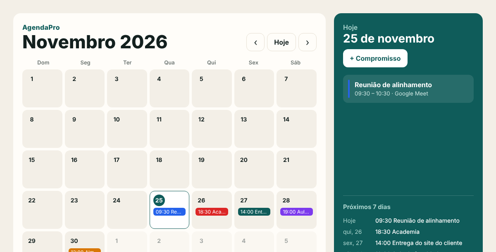

# AgendaPro — Calendário de compromissos

Calendário interativo onde é possível adicionar, editar e remover compromissos em qualquer data.

🔗 **[Ver o site no ar](https://iamviniciuslima05.github.io/PROJETO-AgendaPro/)**



## Funcionalidades

- Calendário mensal com navegação entre meses e botão **Hoje**
- Compromissos com título, data, horário de início e fim, **categoria com cor**, local e observações
- **Adicionar, editar e excluir** compromissos
- Painel do dia selecionado e lista dos **próximos 7 dias**
- Aviso de **conflito de horário**
- Navegação pelo teclado com as setas
- Versão mobile com pontinhos coloridos nos dias
- Tudo salvo no **localStorage**

## Tecnologias

HTML5 · CSS3 · JavaScript · localStorage

## Estrutura

```
index.html
css/style.css
js/script.js
```

## Como rodar

Não precisa instalar nada: baixe o projeto e abra o `index.html` no navegador, ou acesse a versão publicada acima.

---
Feito por **Vinicius Lima** · [Portfólio](https://viniciuslimadev.netlify.app) · [LinkedIn](https://www.linkedin.com/in/viniciuslima25/)
